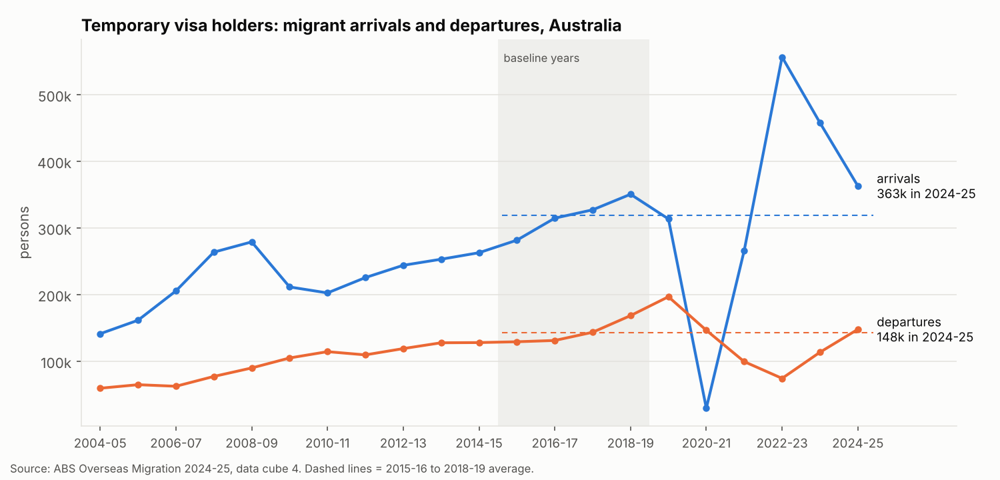
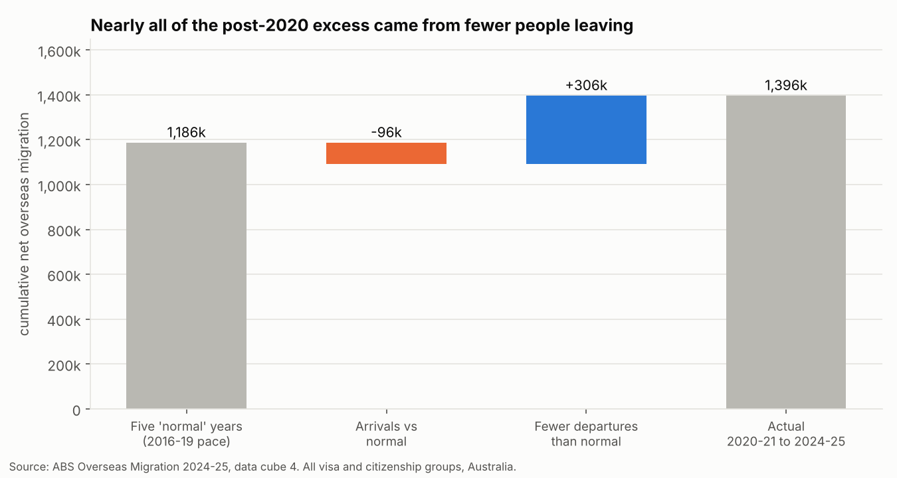
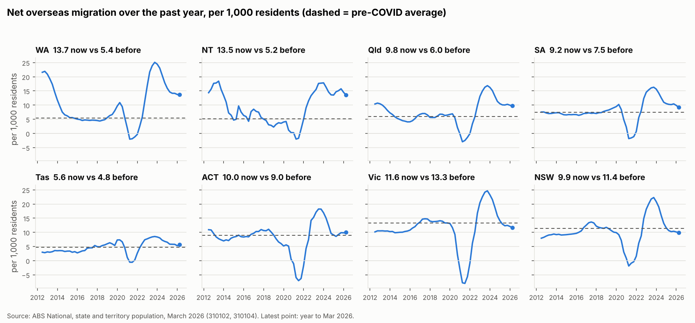
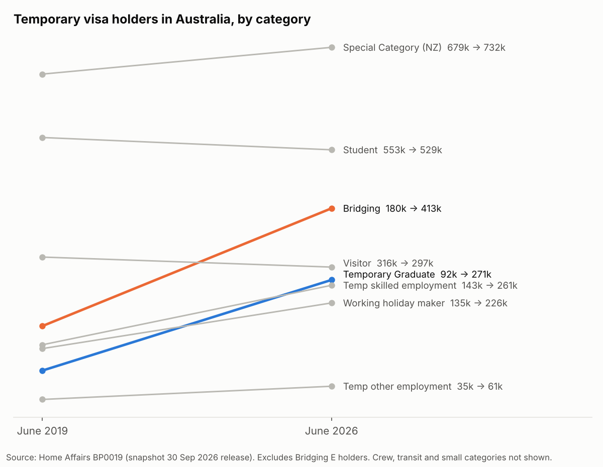

# Overseas migration after 2020: arrivals or departures?

**The question:** Australia's net overseas migration hit a record 538,000 in 2022-23. If you're
planning demand or pricing by state, is that a wave that rolls back out? Or did those people
stay? And which states are still running above their normal pace?

## For a manager with two minutes

The 2022-23 spike looks like a surge of arrivals, but it was mostly people **not leaving**.
Over 2020-21 to 2024-25, Australia took in about 210,000 more net migrants than the pre-COVID
pace would have produced. Fewer departures than normal account for about 306,000. Arrivals
were actually a bit *below* normal over the five years. The Home Affairs data agrees with this.
There were 2.81 million temporary visa holders in the country in June 2026, up 642,000 on
June 2019. The growth is in graduate and bridging visas, not student visas.

**Implication:** don't plan on the post-2020 population rolling back out on its own. Those
people are still here, and departures are the number to watch. Second, use each state's
current rate, not its old normal and not the national average. Relative to their own history,
WA, the NT and Queensland are running well above normal, while NSW and Victoria are below. So a
"back to pre-COVID" assumption overshoots Sydney and Melbourne and undershoots Perth, Darwin and
Brisbane. A single national rate doesn't fix it either. In the year to March 2026, WA and the NT
ran about 30% above the national 10.6 per 1,000, and Tasmania about half of it.

## Data

| Source | Dataset and file | Release | Licence | Retrieved |
|---|---|---|---|---|
| Australian Bureau of Statistics | Overseas Migration, 2024-25, data cube 4: *Overseas migrant arrivals and departures by visa and citizenship groups, state/territory, financial years 2004-05 to 2024-25* (`34070DO004_202425.xlsx`) | 19 Dec 2025 | CC BY 4.0 | 15 Nov 2026 |
| Australian Bureau of Statistics | National, state and territory population, March 2026: *Components of population change, states and territories* (`310102.xlsx`) and *Population, states and territories* (`310104.xlsx`) | 17 Sep 2026 | CC BY 4.0 | 15 Nov 2026 |
| Department of Home Affairs (via data.gov.au) | Temporary visa holders in Australia, *BP0019 Number of Temporary visa holders in Australia at 2026-09-30* (`bp0019l-...-v100.xlsx`) | Oct 2026 | CC BY 2.5 AU | 15 Nov 2026 |

Pages:
- https://www.abs.gov.au/statistics/people/population/overseas-migration/latest-release
- https://www.abs.gov.au/statistics/people/population/national-state-and-territory-population/latest-release
- https://data.gov.au/data/dataset/temporary-entrants-visa-holders

Source for Home Affairs figures: Department of Home Affairs. The views and analysis here are
mine and don't necessarily represent those of the Department of Home Affairs.

All raw files are under 3 MB and sit untouched in `data/raw`. `src/download_data.py` re-fetches
the ABS ones, and the Home Affairs file has to be downloaded by hand (its name changes monthly).

## Method

1. **Clean** (`src/prepare_data.py`). This reshapes the three workbooks into tidy CSVs. The ABS
   cube has a different header row on the Australia sheet and needs footnote letters stripped
   from labels. The Home Affairs file hides its pre-2018 data behind a pivot filter, so I read the
   pivot cache XML directly. Every step logs row counts. See `cleaning_log.md`.
2. **Split net into arrivals and departures.** For 2020-21 to 2024-25 I compare each flow with
   five years at the 2015-16 to 2018-19 average. Then I rerun with five other baselines to see
   how much the answer depends on that choice.
3. **State rates.** From the quarterly release (to March 2026), I take rolling four-quarter NOM
   per 1,000 residents. The base is the population a year earlier. I compare it with each state's
   own pre-COVID average.
4. **Revision check.** The 2024-25 numbers appear in two releases nine months apart. Comparing
   them shows how much preliminary figures move.
5. **Stock check.** I use Home Affairs counts of temporary visa holders on the June snapshot
   each year, as a sanity check on the departures story.

Everything is in `notebooks/overseas_migration_analysis.ipynb`. It reruns the cleaning first, so
it always works from the raw files.

I didn't use SQL here. The data is a handful of small tables and the work is reshaping and
arithmetic, so pandas was the natural fit.

## Findings

### 1. The surge was mostly fewer people leaving



Temporary visa arrivals did spike in 2022-23 (557k). But the real break is departures. Only
74k temporary visa holders left that year, about half the pre-COVID average of 143k.



Over the five years from 2020-21 to 2024-25, net migration was 1.40m against 1.19m at the
pre-COVID pace. That's an excess of about 210k. In the main version of the split, fewer
departures contribute +306k and arrivals contribute -96k.

How sure am I? It depends on what counts as "normal":

| Baseline | Excess net | From arrivals | From fewer departures |
|---|---|---|---|
| 2011-12 to 2018-19 | 282k | +46k | +235k |
| 2013-14 to 2017-18 | 316k | +51k | +265k |
| 2014-15 to 2018-19 | 263k | -35k | +297k |
| **2015-16 to 2018-19 (main)** | **210k** | **-96k** | **+306k** |
| 2016-17 to 2018-19 | 158k | -159k | +317k |
| Linear trend 2009-10 to 2018-19 | 86k | -423k | +509k |

The departures effect is between +235k and +317k under every flat baseline. The arrivals effect
changes sign depending on the baseline, so the honest summary is "arrivals were roughly normal".
The trend baseline assumes departures would have kept rising at their 2010s rate. I show it
for completeness but don't lean on it.

By visa group (main baseline), the biggest excesses are students (+108k), working holiday
makers (+77k), NZ citizens (+73k) and temporary skilled (+63k). Visitors (-57k) and permanent
skilled (-41k) came in below their old pace.

### 2. Nationally the inflow is near normal again. By state it isn't.



| State | Pre-COVID avg (per 1,000) | Peak since 2021 | Year to Mar 2026 | Now vs before |
|---|---|---|---|---|
| NT | 5.2 | 17.9 | 13.5 | 2.6x |
| WA | 5.4 | 25.1 | 13.7 | 2.5x |
| Qld | 6.0 | 16.9 | 9.8 | 1.6x |
| SA | 7.5 | 16.3 | 9.2 | 1.2x |
| Tas | 4.8 | 8.5 | 5.6 | 1.2x |
| ACT | 9.0 | 18.2 | 10.0 | 1.1x |
| **Australia** | **9.6** | **21.2** | **10.6** | **1.1x** |
| Vic | 13.3 | 24.6 | 11.6 | 0.9x |
| NSW | 11.4 | 22.3 | 9.9 | 0.9x |

This is the finding that isn't visible in the national chart. Sydney and Melbourne take the
most migrants in absolute terms, but per head they're now below their own pre-COVID rates.
Two different comparisons are going on in this table, and they give different answers.
Against its own history, Queensland is 1.6 times normal. Against the national rate, it's
slightly *below* average (9.8 vs 10.6). Victoria is the reverse: below its own normal, but
above the national rate. Only WA and the NT are high on both measures. WA
also had the largest five-year excess per head (+42 per 1,000 residents). It was the only state
where arrivals clearly beat the baseline. WA's ratio is flattered by a low baseline, though,
because 2015-2019 was the trough after the mining boom.

### 3. The people who stayed moved onto other visas



There were 2.17m temporary visa holders in June 2019 and 2.81m in June 2026. Student holders
are actually slightly *down* (553k to 529k). The growth is Bridging (+233k), Temporary Graduate
(+179k), temporary skilled (+118k) and working holiday makers (+90k). India is about a third of
Temporary Graduate holders, and Nepal and China another quarter between them.

## What surprised me and what didn't work

**Victoria finished below its pre-COVID pace.** Over 2020-21 to 2024-25 it took in about 31k
*fewer* net migrants than the 2015-19 pace would have given. Per head, its 2020-21 outflow was
the deepest of any state. The 2023 surge, big as it was in Melbourne, never fully made that up.
I expected Victoria to be near the top.

**Matching the two sources visa by visa didn't work.** ABS net migration says about 605k net
students arrived between 2019-20 and 2024-25. Home Affairs says the student stock grew by 39k.
Even across all temporary visas the gap is around 680k. That isn't an error. It's a definition
mismatch. The ABS records the visa held *when crossing the border*, so a student who later leaves
on a graduate visa counts as + student, - other temporary. And anyone who gets a permanent visa
onshore leaves the Home Affairs temporary count without leaving the country. I dropped the
group-by-group comparison and only use the stock as a direction check.

**The quarterly Home Affairs snapshots were useless until I switched to June only.** The
student count drops by about 157k between the September and December snapshots, and visitors
jump by about 303k over the same three months (2025 figures). That's just students heading
home for summer and Christmas tourists. Before I noticed, quarter-on-quarter changes looked
like random noise. See `images/06_snapshot_seasonality.png`.

**Preliminary state numbers move a lot.** Between the December 2025 and September 2026 releases,
2024-25 NOM was revised by -1.3% nationally. Tasmania moved +22%, the ACT -11% and the NT +9%.

## How this compares with published work

The main finding isn't new. Peter McDonald (ANU/CEPAR) pointed out in 2023 that the
post-COVID jump in net migration was driven more by people not leaving than by arrivals,
and the ANU Migration Hub's 2026 report "Can Australia Achieve a Migration Soft Landing?"
makes the same case. The growth in bridging and graduate visa holders is also tracked
regularly by commentators using the same Home Affairs data. My numbers line up with theirs,
and with the ABS's own note that temporary visa departures in 2024-25 (148k) were back above
the pre-pandemic average.

What I've tried to add is the checking around it: how much the arrivals/departures split
depends on the choice of baseline, how far the preliminary 2024-25 state figures have
already been revised, why the ABS and Home Affairs numbers can't be matched visa by visa,
and a state-by-state view aimed at demand planning.

One point of difference worth being clear about. I compare each state with its own
pre-COVID rate, and on that measure WA, the NT and Queensland are well above normal.
McDonald compares states with the national pattern and finds Queensland and WA
unexceptional. Both can be true. Queensland's current rate (9.8 per 1,000) is below the
national 10.6. It's just high for Queensland.

Further reading:
- Peter McDonald, "What's behind the recent surge in Australia's net migration – and will it last?", The Conversation, April 2023
- ANU Migration Hub, "Can Australia Achieve a Migration Soft Landing?", 2026
- ANU Policy Brief, "Migration is falling fast – but election politics is spinning a different story"

## What the data can't tell us

- **Why people stayed.** This is accounting, not causation. Closed borders, a tight labour
  market, changes to graduate visa rules and processing backlogs (which grow the bridging
  count) all plausibly played a part. Nothing here separates them.
- **What happens to the bridging and graduate cohort.** The data doesn't say how many will get
  permanent visas and how many will leave. That's the swing factor for departures over the next
  few years.
- **State detail for Home Affairs.** BP0019 is national only, so I can't check the state
  findings against visa holder stocks.
- **Definitions.** NOM uses the 12/16 month rule. Someone has to be in (or out of) Australia
  for 12 of 16 months, so the latest quarters are modelled rather than observed. The ABS visa
  groups and Home Affairs categories don't map one to one. Home Affairs excludes Bridging E
  holders, dropped subclass 449 from July 2025, and notes a change of data source with revised
  figures.
- **Rounding.** The ABS rounds every cell to the nearest 10, which is why my derived
  "unknown visa" row is occasionally slightly negative. It doesn't matter at the scale of these
  findings.
- **Baseline choice.** "Normal" is an assumption. The sensitivity table above shows how much it
  matters.

## Power BI version

`powerbi/` has the star schema, the Power Query M for each table, 10 DAX measures, a sketch of
each report page, and the list of screenshots to take.

<!-- Screenshots go here once the report is built:


-->

## How to run

```
python -m venv .venv

# Windows
.venv\Scripts\activate
# Mac / Linux
source .venv/bin/activate

pip install -r requirements.txt

# optional: rebuild data/processed from data/raw
python src/prepare_data.py

jupyter notebook notebooks/overseas_migration_analysis.ipynb
```

Run the notebook from the `notebooks/` folder. It calls `prepare_data.py` itself, so the
second step is optional.

## Repo layout

```
data/raw/                 original files, untouched
data/processed/           tidy CSVs written by src/prepare_data.py
notebooks/                the analysis, with outputs
src/prepare_data.py       cleaning and checks
src/chart_style.py        shared chart settings
src/download_data.py      re-fetches the ABS files
powerbi/                  model, Power Query, DAX, page sketches
images/                   charts used above
cleaning_log.md           what was dropped, renamed or fixed, with row counts
```

## Author

Syaddanpudi
